# Enhancing Student Performance Through EEG-AI Based Classroom Device

### A wearable EEG prototype for exploring attention, classroom engagement, and AI-assisted analysis.

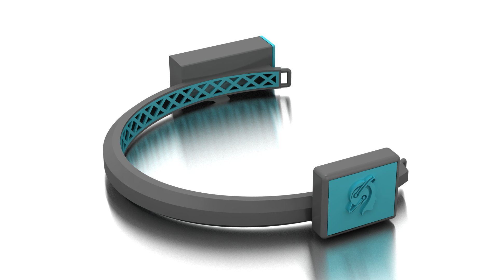

**Final-year project · Wearable electronics · Python desktop dashboard · MATLAB/EEGLAB exploration · Offline machine learning**

This project explored how a wearable EEG device could help make changes in student attention more visible during learning. The work covered a TGAM-based headband, enclosure design, Bluetooth serial acquisition, a Python dashboard, data logging, MATLAB analysis, and a separate deep-learning experiment on a public EEG dataset.

**Repository status:** documented research prototype. The supplied live application displays the **TGAM module's attention score**; it does not run the notebook's trained AI model. The historical code is included with known issues so that the project can be understood and improved. The title describes the intended educational application; an improvement in student grades or learning outcomes has not been established by the supplied evidence.

**Explore the original work:** [Visual gallery](docs/GALLERY.md) · [PowerPoint presentation](supporting-documents/Project-Presentation.pptx) · [Results slides PDF](supporting-documents/Results-and-Discussion-Slides.pdf) · [Full project report](supporting-documents/Final-Year-Project-Report.docx) · [All supporting documents](supporting-documents/README.md)

## Contents

- [Problem and objectives](#problem-and-objectives)
- [The project from start to end](#the-project-from-start-to-end)
- [System block diagrams](#system-block-diagrams)
- [Hardware and enclosure](#hardware-and-enclosure)
- [Software and live dashboard](#software-and-live-dashboard)
- [Data, signal analysis, and AI](#data-signal-analysis-and-ai)
- [Results and current status](#results-and-current-status)
- [Original presentations and supporting documents](#original-presentations-and-supporting-documents)
- [Repository structure](#repository-structure)
- [Setup and reproduction](#setup-and-reproduction)
- [Engineering domains and skills](#engineering-domains-and-skills)
- [What should be updated next](#what-should-be-updated-next)
- [Team and references](#team-and-references)

## Problem and objectives

Teachers normally infer engagement from participation, classroom behavior, and assessment results. These observations do not provide a continuous view of the signals associated with a student's changing attention. This project investigated a wearable EEG approach to supplement those observations and explored whether EEG features could support automated analysis.

The practical objectives were to:

1. Integrate an EEG acquisition module into a wearable headband.
2. Transfer its measurements wirelessly to a computer.
3. Present attention values and selected band-power features in an understandable dashboard.
4. Record measurements for later examination.
5. Explore EEG-related data using MATLAB and EEGLAB.
6. Experiment with AI classification using an available public dataset.

The prototype addresses acquisition, visualization, and exploratory analysis. EEG-derived attention is a proxy that requires context and validation; it is not a direct measurement of understanding, intelligence, or academic performance.

## The project from start to end

| Stage | Work carried out | Evidence and outcome |
|---|---|---|
| 1. Problem definition | Studied attention monitoring and the possible role of EEG in classrooms | Proposal, report, research notes, and presentations in the original project collection |
| 2. Hardware exploration | Investigated EEG acquisition, electrodes, communication, and alternative architectures | TGAM-based implementation is supported; several controller/cloud options remained proposal material |
| 3. Wearable design | Developed an enclosure/headband arrangement for the electronics | CAD images, physical prototype photographs, and four STL parts |
| 4. Acquisition | Received ThinkGear-style packets over a Bluetooth serial connection | Python serial reader with synchronization and checksum handling |
| 5. Visualization | Built a student-oriented desktop interface | Tkinter interface, attention gauge, selected band plots, student details, and session-derived daily averages |
| 6. Logging | Wrote attention readings and timestamps to CSV | Logging functions in the live Python application |
| 7. Data exploration | Examined EEG-related columns and prepared data for EEGLAB | Two MATLAB scripts and original analysis files |
| 8. AI experimentation | Explored binary confused-student classification on public EEG data | Jupyter notebook with a convolutional/BiLSTM model and saved training outputs |
| 9. Results communication | Presented device construction, plots, examples, and comparisons | Report, result slides, and analysis screenshots |
| 10. Review and packaging | Organized the supplied work and identified reproducibility gaps | This repository, source provenance, issue register, and roadmap |

The final prototype and the offline AI experiment are separate workstreams. Connecting them into a validated live inference system is a future milestone.

## System block diagrams

### Implemented live prototype

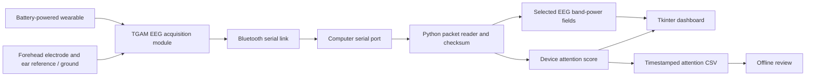

The packet reader's band-power parsing needs correction before its displayed band values can be trusted. See the [reproducible issue](docs/KNOWN_ISSUES.md).

### Separate offline AI experiment

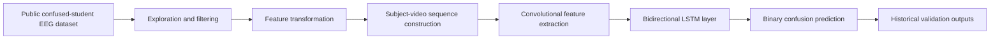

This shows the experiment's intended flow. Its sequence construction and evaluation have important limitations documented in [AI and data](docs/AI_AND_DATA.md). There is no implemented connection from this model to the live dashboard.

## Hardware and enclosure

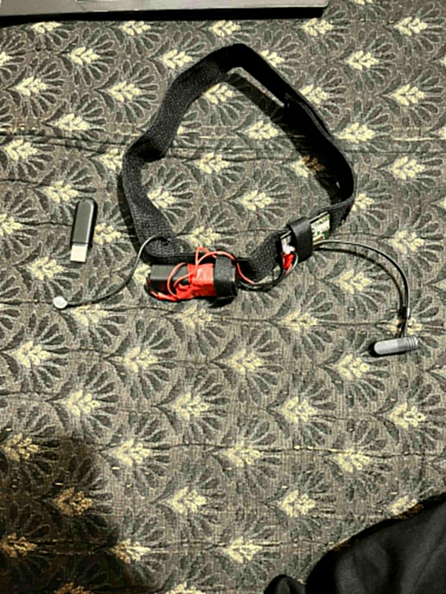

| Component | Role | What is established |
|---|---|---|
| TGAM EEG module | EEG acquisition and device-generated metrics | Described in project documentation and used by the supplied serial protocol code |
| Dry electrode arrangement | Contact with the forehead | Report describes the Fp1 location |
| Reference/ground contacts | Reference for the acquisition arrangement | Ear reference, described as A1 in the report; exact wiring still needs a verified schematic |
| Bluetooth serial module/link | Wireless transfer to the computer | Serial acquisition code and prototype documentation; exact module model unconfirmed |
| Battery/power arrangement | Portable headband operation | Visible/described prototype; exact cell, regulator, ratings, and measured runtime unconfirmed |
| Headband and enclosure | Hold the electronics and sensor arrangement | Design images, prototype photos, and supplied STL files |
| Computer | Run visualization, logging, and offline tools | Python desktop application, MATLAB scripts, and notebook |

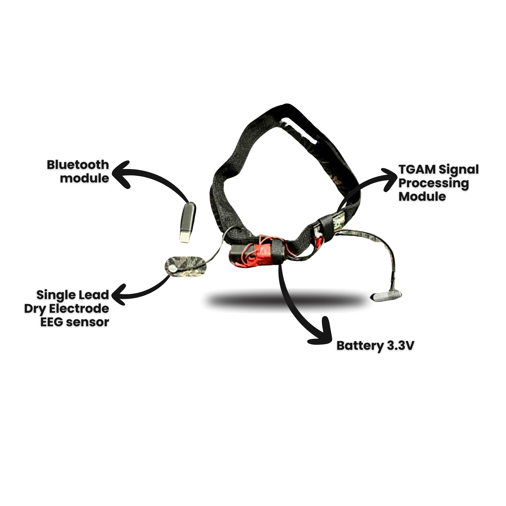

*Original project illustration. Component labels document the historical design; the voltage label is not a verified wiring specification.*

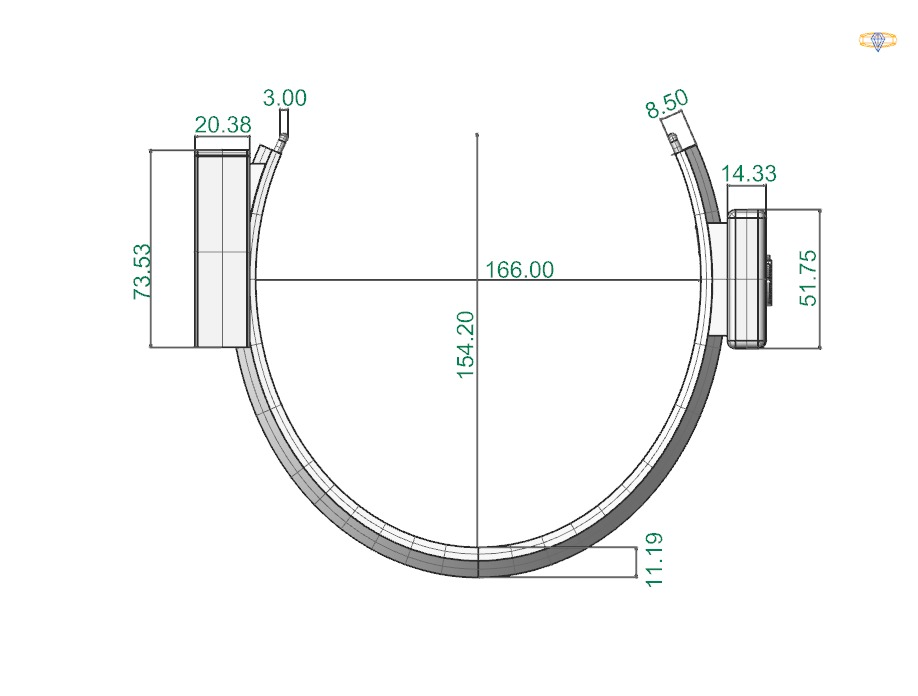

The [enclosure directory](hardware/enclosure/) includes the main case, inner wall, and two caps. The supplied files do not establish printing material, tolerances, or the original CAD software. See [hardware documentation](docs/HARDWARE.md) for the build evidence and missing specifications.

### Assembled headband from the results presentation

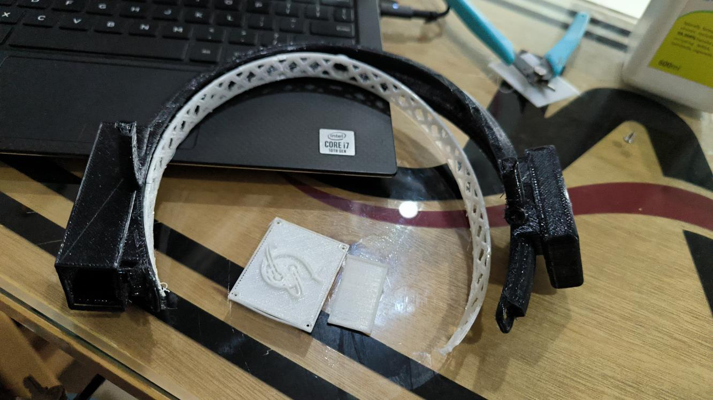

*Original photograph extracted from page 8 of the [results slides](supporting-documents/Results-and-Discussion-Slides.pdf). The [gallery](docs/GALLERY.md#hardware-and-electronics) also includes the printed enclosure, breadboard exploration, and circuit simulation images from the PowerPoint.*

## Software and live dashboard

The Python application combines serial acquisition with a Tkinter desktop GUI and Matplotlib visualization.

| Part | Existing implementation |
|---|---|
| Connection | Serial port at 57,600 baud; default port `COM4` in the source |
| Packet reader | Looks for `AA AA`, reads payload length and payload, checks checksum |
| Attention | Reads the device-provided `0x04` value |
| Band-power display | Attempts to read high-alpha, high-beta, and mid-gamma from `0x83`; known offset defect |
| Plot history | Maintains the latest 100 entries for plotting |
| Interface | Student details/photo, attention gauge, band plots, and daily average display |
| Threading | Serial reader runs in a background thread; GUI callbacks use `root.after` |
| CSV | Saves `Time` and `Attention` after each group of ten new entries |
| Categories | Uses attention thresholds at 40, 60, and 80; these are interface rules, not validated educational classes |

The daily averages come from data collected by the current running process. They are not a persistent historical database. The CSV does not record raw EEG, all power bands, or signal quality. See [software documentation](docs/SOFTWARE.md) for behavior, configuration, and failure modes.

### Original Python GUI

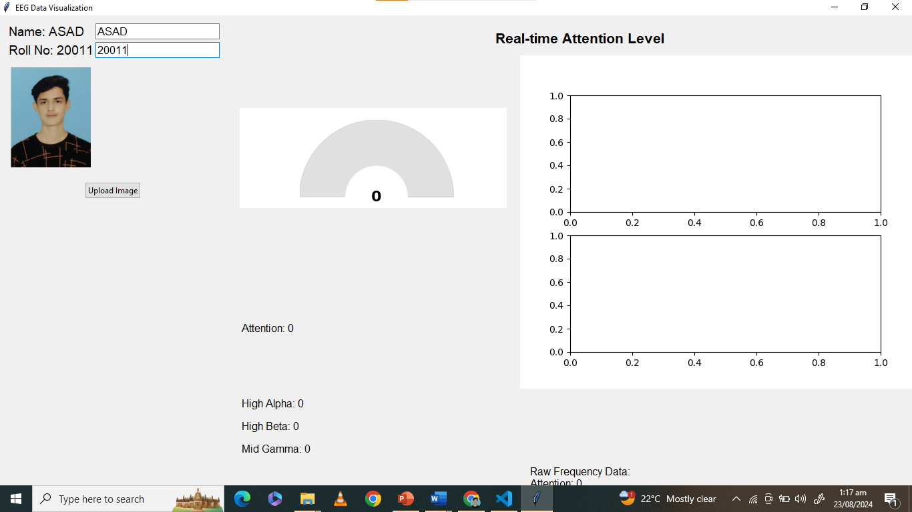

*Screenshot extracted from results slide 36. This capture shows the interface with zero values and empty plotting areas; it documents the UI layout, not a newly executed live session.*

### EEG monitoring plots shown in the results

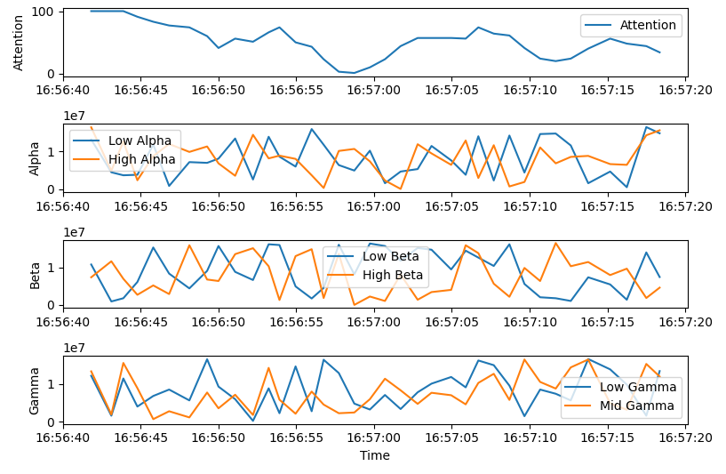

*Extracted from results slide 34. This historical display includes more band traces than the supplied Python application's selected-band view. Its exact generating code/run is not established. Original labels are preserved; band values must be interpreted alongside the [parser and data limitations](docs/KNOWN_ISSUES.md).*

## Data, signal analysis, and AI

### Public dataset experiment

The supplied `EEG_data_college_students.csv` contains 12,811 rows, 15 columns, 10 subjects, and 10 videos. The notebook explores attention, meditation-related values, raw readings, and band-power features to predict a binary confusion label.

Its model uses convolutional layers wrapped in `TimeDistributed`, pooling and flattening, a bidirectional LSTM, and a sigmoid output. Two sequence-length variants are present, using 112 and 144 samples. The notebook records training for 100 epochs with Adam and binary cross-entropy.

**Historical result:** saved outputs show 100% training accuracy and 75% evaluation accuracy for both variants. These are stored notebook outputs, not newly reproduced results and not a validated accuracy claim for the wearable. Preprocessing leakage, empty sequence slots, participant overlap, and reuse of validation data prevent a reliable generalization claim. [Read the full evaluation review](docs/AI_AND_DATA.md).

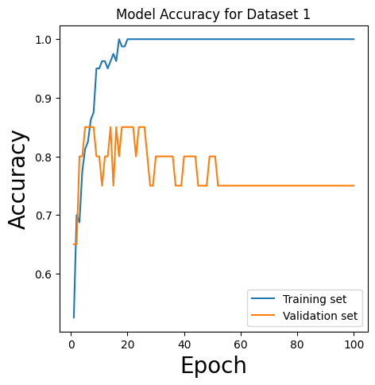

*Original saved notebook output. The training curve reaches 1.0 while validation settles around 0.75. This visual is retained as a record of the experiment, with the evaluation limitations above.*

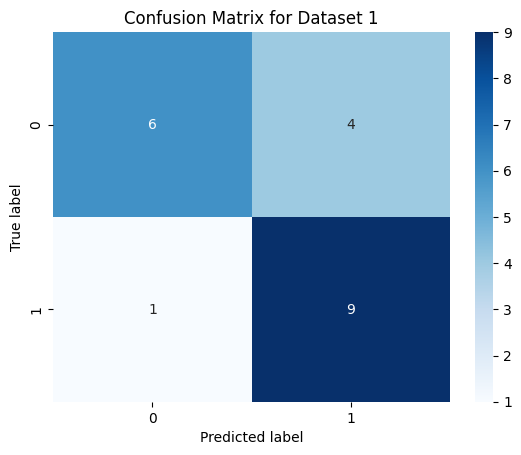

*The saved matrix contains 15 correct predictions out of 20 entries. The PowerPoint's slide 36 contains a different historical matrix (17/20); its run cannot be reconciled from the supplied files. Both sources are preserved and separately labeled in the [gallery](docs/GALLERY.md#ai-experiment-and-saved-model-outputs).*

### Local/transformed dataset

The supplied `concentration_data.csv` has 1,960 rows and six columns. Its frequency-to-attention relationship is strongly structured, and its transformation/collection process is not fully documented. It must not be presented as verified independent physiological ground truth or a classroom outcome dataset.

Datasets are not redistributed in this publication package. [Data instructions](data/README.md) describe the public source and what must be established before sharing local participant data.

### MATLAB and EEGLAB

- `eegcode.m` selects existing band columns, averages paired alpha/beta/gamma columns, plots them, and saves a MATLAB file. It does not extract spectral bands from raw EEG using FFT or wavelets.
- `eegnew.m` converts numeric CSV columns into an EEGLAB-style structure and saves a set. Its assumed 256 Hz rate and interpretation of columns as channels require review.
- Reports contain further signal-processing discussion and screenshots. These do not establish a complete reproducible FFT/ICA/wavelet pipeline in the supplied scripts.

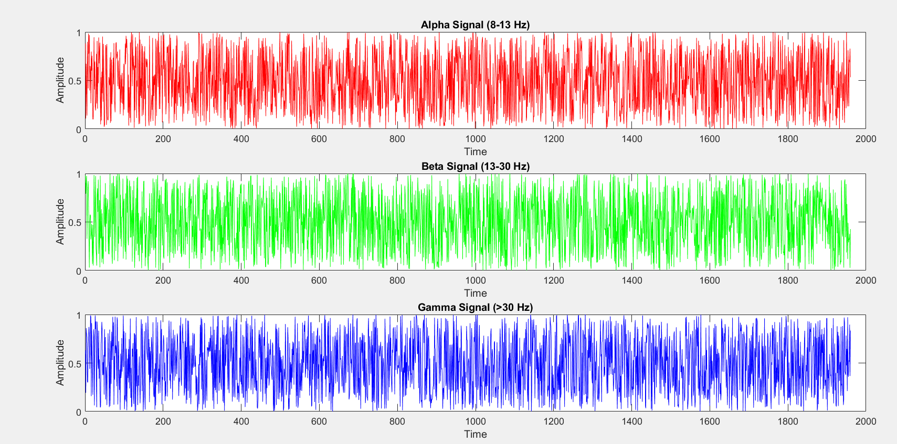

*Extracted directly from PowerPoint slide 21. It preserves the original plotted output; feature units and the assumed time axis require the interpretation described in [AI and data](docs/AI_AND_DATA.md#6-matlab-and-eeglab-scope).*

### Additional reporting

Power BI screenshots support exploratory reporting work, but no editable `.pbix` file was supplied. A Random Forest attention-regression example appears in a report appendix; its referenced training file and exported model are absent, and it is not used by the live application.

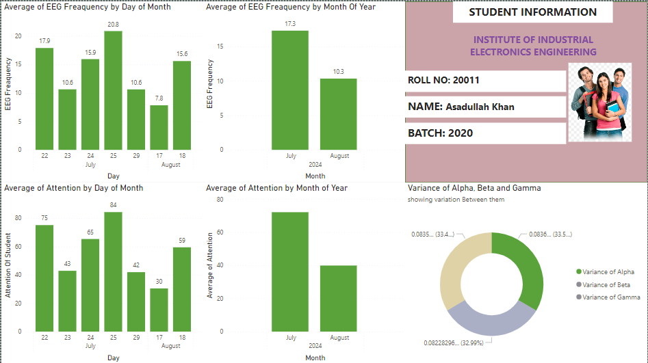

*Extracted from results slide 37. The dashboard combines historical daily/monthly charts and a variance visualization. It is a reporting screenshot, not a validated longitudinal study or a dashboard regenerated from the packaged Python CSV.*

The [full visual gallery](docs/GALLERY.md) includes 35 additional extracted figures, including daily and monthly charts, feature distributions, correlation heatmap, model architecture, training loss, both notebook confusion matrices, and the original presentation's figures. Images retain their source content and are not AI-generated substitutes.

## Results and current status

| Area | Status | Interpretation |
|---|---|---|
| Wearable assembly and enclosure | Prototype evidence available | Design files and photographs establish physical development |
| Serial dashboard and logging | Code supplied | Live hardware execution was not repeated during repository preparation |
| Packet band-power decoding | Correction required | An isolated protocol fixture reproduces an offset error |
| MATLAB exploration | Scripts supplied | Sampling and channel assumptions require validation |
| Offline AI notebook | Historical experiment available | Saved outputs preserved; evaluation must be redesigned |
| Live trained-model inference | Not implemented in supplied application | TGAM attention drives the interface |
| Reliable long-term classroom operation | Not established | Recovery, signal-quality handling, and durable session storage need work |
| Better student learning outcomes | Not established | Requires a controlled educational study |
| Cloud/mobile/multi-student deployment | Proposed or unverified | No matching deployable implementation in the reviewed files |

## Original presentations and supporting documents

| Document | Contents |
|---|---|
| [Project presentation — PPTX](supporting-documents/Project-Presentation.pptx) | Original 38-slide editable presentation, including circuits, acquisition screenshots, MATLAB/EEGLAB exploration, and AI figures |
| [Presentation archive — PDF](supporting-documents/Project-Presentation-Archive.pdf) | Separate original 61-page presentation document; not a newly generated export of the 38-slide PPTX |
| [Results and discussion slides — PDF](supporting-documents/Results-and-Discussion-Slides.pdf) | Original 45-page results presentation with hardware, GUI, monitoring plots, and Power BI figures |
| [Full final-year project report — DOCX](supporting-documents/Final-Year-Project-Report.docx) | Complete original report, including methodology and appendices |
| [Research manuscript draft — PDF](supporting-documents/Research-Manuscript-Draft.pdf) | Nine-page research/system-model draft |
| [Results discussion write-up — PDF](supporting-documents/Results-Discussion-Writeup.pdf) | Six-page written discussion with figures |

These originals preserve the project's history, including preliminary proposals and interpretations that differ from the reviewed implementation. Read the [document guide](supporting-documents/README.md) for source mapping and limitations. The report is approximately 69.4 MiB; use GitHub Desktop or command-line Git to upload the complete package, as explained in [publishing instructions](docs/PUBLISHING.md).

## Repository structure

```text
EEG-AI-Classroom-Device/
|-- README.md
|-- LICENSE-NOTICE.md
|-- software/
|   |-- tgam_dashboard.py
|   `-- requirements.txt
|-- notebooks/
|   |-- confused_student_identification.ipynb
|   `-- requirements.txt
|-- matlab/
|   |-- eegcode.m
|   `-- eegnew.m
|-- hardware/enclosure/           Four supplied STL parts
|-- supporting-documents/         Original PPTX, full DOCX report, four PDFs, and source guide
|-- data/                        Dataset instructions; no participant data
|-- tools/audit_parser.py         Isolated known-defect reproduction
`-- docs/
    |-- HARDWARE.md
    |-- SOFTWARE.md
    |-- AI_AND_DATA.md
    |-- KNOWN_ISSUES.md
    |-- ROADMAP.md
    |-- SKILLS.md
    |-- PUBLISHING.md
    |-- GALLERY.md
    |-- ASSET_PROVENANCE.json
    |-- VISUAL_INDEX.json
    `-- images/                  Hardware, presentation, GUI, graphs, and notebook figures
```

## Setup and reproduction

### 1. Prepare the desktop environment

Use Python with Tkinter support. From this repository's root in Windows PowerShell:

```powershell
python -m venv .venv
.\.venv\Scripts\python.exe -m pip install -r software/requirements.txt
.\.venv\Scripts\python.exe -m tkinter
```

The requirements list the imports needed by the supplied application. An original lockfile was not supplied, so compatibility with a newly installed environment remains to be tested and recorded.

### 2. Reproduce the known parser issue without hardware

```powershell
.\.venv\Scripts\python.exe tools/audit_parser.py
```

For the supplied parser, this intentionally exits with code 1 and prints the incorrect decoded values. The script extracts only the parser function and does not start the GUI or open a serial port. Correct decoding is a prerequisite for trusting band-power plots.

### 3. Configure the wearable connection

Pair the verified Bluetooth serial device with the computer and identify its serial port. In `software/tgam_dashboard.py`, change the `COM4` argument to the actual port. Confirm that the module's configuration matches the source's 57,600 baud setting.

The output folder is `data/local/`. Change the CSV filename for each session: the historical code can overwrite a previous file with the same name. Review the [known issues](docs/KNOWN_ISSUES.md) before collecting data.

### 4. Start the historical dashboard

```powershell
.\.venv\Scripts\python.exe software/tgam_dashboard.py
```

This is a prototype launch procedure, not confirmation that the current implementation is ready for unsupervised data collection. Validate the parser, connection behavior, and saved data with the actual hardware.

### 5. Inspect or reproduce the offline notebook

Obtain the public dataset using [data/README.md](data/README.md), then:

```powershell
.\.venv\Scripts\python.exe -m pip install -r notebooks/requirements.txt
Set-Location notebooks
..\.venv\Scripts\python.exe -m jupyter notebook
```

Open `confused_student_identification.ipynb`. Local paths have been adapted; saved analytical outputs remain from the original notebook. Model plotting may additionally require the Graphviz executable. TensorFlow compatibility depends on the selected Python/platform combination. Fix the documented data/evaluation issues before reporting new performance results.

### 6. Inspect the MATLAB scripts

Provide the CSVs named in each script through MATLAB's working directory or edit the input paths. For `eegnew.m`, install EEGLAB separately and initialize its workspace first. Verify the meaning and actual sampling rate of every input before creating an EEGLAB dataset. Do not infer a 256 Hz acquisition rate from the example constant in the scripts.

## Engineering domains and skills

| Domain | Work represented in this project | Skills demonstrated or explored |
|---|---|---|
| Biomedical instrumentation | Electrode arrangement and EEG module integration | Biosignal acquisition concepts, reference contacts, contact-quality awareness |
| Electronics and wearable integration | TGAM, wireless link, portable assembly | Module interfacing, system integration, practical prototype assembly |
| Mechanical design | Headband/enclosure design and four printable parts | Enclosure design, component placement, CAD-to-STL workflow |
| Communication protocols | ThinkGear-style binary data over serial | UART/serial concepts, framing, checksum verification, binary parsing |
| Python application development | Acquisition, visualization, and logging | Python, PySerial, Tkinter, Matplotlib, pandas, NumPy, threading |
| Signal/data analysis | Band-feature exploration and MATLAB work | Time-series plotting, feature interpretation, MATLAB and EEGLAB exploration |
| Machine learning | Separate confused-student notebook | Data preparation, CNN/BiLSTM experimentation, TensorFlow/Keras, classification metrics |
| Reporting and visualization | Dashboard, result slides, and Power BI figures | Data visualization, comparative reporting, technical presentation |
| Research and engineering evaluation | Literature, prototype results, limitations | Experiment documentation, critical interpretation, reproducibility planning |

These domains do not automatically establish custom embedded firmware, a cloud IoT deployment, clinical validation, or production AI deployment. [Skills documentation](docs/SKILLS.md) gives precise language for describing the contribution.

## What should be updated next

The following are **recommended next steps**, not claims that development is currently underway:

1. **Correct packet parsing:** respect the `0x83` length byte and all protocol field lengths; verify against known packets and actual hardware.
2. **Make acquisition dependable:** monitor signal quality, handle partial reads and disconnects, and shut down cleanly.
3. **Improve session records:** use unique files, preserve final readings, and record quality, relevant features, metadata, and timestamps.
4. **Document the exact build:** add a verified bill of materials, wiring diagram, power measurements, and enclosure assembly instructions.
5. **Establish data provenance:** separate public data, locally collected data, and transformed examples, with collection and labeling records.
6. **Rebuild ML evaluation:** remove empty sequences, split by participant before fitting preprocessing, use a meaningful temporal axis, and hold out an untouched test set.
7. **Integrate AI only after validation:** export the full preprocessing/model pipeline and verify compatibility with the live device's features.
8. **Evaluate educational value:** assess usability and learning outcomes through an appropriate study, rather than equating attention scores with academic success.
9. **Improve reproducibility:** record dependency versions, sample replay packets, benchmark results, and a repeatable installation procedure.

See the [roadmap](docs/ROADMAP.md) for priorities and completion criteria, and the [issue register](docs/KNOWN_ISSUES.md) for current technical gaps.

## Team and references

This is a team final-year project. The supplied materials list **Anas Hussain Khan, Asadullah Khan, Taimoor Ali, and Syed Shokat Ali**. Anas reports involvement across all project areas. This documentation does not assign sole authorship of shared work or invent individual task allocations.

- [NeuroSky ThinkGear communications protocol](https://developer.neurosky.com/docs/doku.php?id=thinkgear_communications_protocol): packet structure, device attention, and EEG power fields.
- [Confused student EEG dataset](https://www.kaggle.com/wanghaohan/confused-eeg/home): public dataset used by the separate notebook.
- [EEGLAB](https://sccn.ucsd.edu/eeglab/): external analysis toolbox; not redistributed here.

The package includes selected original reports/presentations and their extracted visuals. Original screenshots and documents retain names, roll numbers, and photographs where present; they have not been anonymized. Public datasets and third-party toolbox/research-paper collections remain excluded. Included code/assets, source locations, and packaging changes are recorded in [asset provenance](docs/ASSET_PROVENANCE.json).

See [LICENSE-NOTICE.md](LICENSE-NOTICE.md) before reuse and [publishing instructions](docs/PUBLISHING.md) to upload this repository, including its images, to GitHub.
