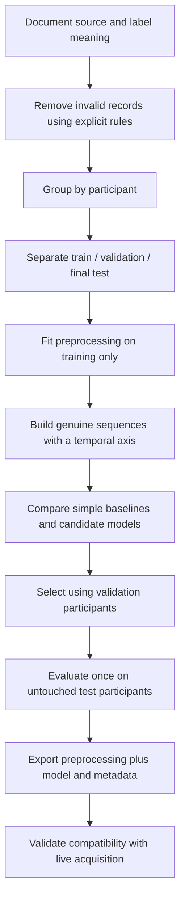

# AI, data, and signal-analysis review

[Back to README](../README.md)

## 1. Three different outputs must be distinguished

| Workstream | Input | Output | Relationship to the live device |
|---|---|---|---|
| Live dashboard | TGAM serial packets | Device attention and selected power fields | Implemented source; parser needs correction |
| Deep-learning notebook | Public confused-student EEG CSV | Binary confusion prediction | Separate offline experiment; no live integration |
| Report appendix example | Referenced training CSV and six band-power features | Random Forest attention regression | Example code in report; required training/model files not supplied |

An attention score, a confusion label, and improved learning outcomes are different quantities. Success at predicting one cannot be assumed to demonstrate another.

## 2. Notebook workflow as supplied

1. Load the public CSV and inspect its columns, missing values, distributions, and labels.
2. Keep rows where both `Attention` and `Mediation` are positive.
3. Preserve subject/video identifiers for grouping, then remove identifiers and the predefined label from the predictor table.
4. Apply logarithmic transformations to power-related columns and a median/IQR-based nonlinear normalization.
5. Construct subject-video samples with two sequence-length choices: truncate to 112 or pad to 144 observations.
6. Split the sequence arrays using a random 80/20 split.
7. Train a convolutional/recurrent network for each representation.
8. Plot training behavior and report evaluation metrics from the held-out portion also used for validation during training.

### Model architecture

The saved code uses `TimeDistributed` convolution layers with 16 filters of size 3×3 and 32 filters of size 5×5, tanh activations, dropout of 0.05, 2×2 max pooling, flattening, a bidirectional LSTM with 75 units and average merge, and a sigmoid output. Training uses Adam, binary cross-entropy, batch size 32, and 100 epochs.

The model's presence demonstrates experimentation with these tools. Its shape and evaluation issues mean architectural complexity should not be used as a substitute for measured validity.

## 3. Observed data dimensions

| Item | Observed value |
|---|---|
| Original CSV | 12,811 rows × 15 columns |
| Subjects/videos | 10 / 10 |
| Original subject-video combinations | 100 |
| Rows after positive attention/meditation filtering | 11,388 |
| Nonempty groups after that filtering | 89 |
| Sequence slots allocated in the notebook | 100 |
| First input array | `(100, 1, 112, 11, 1)` |
| Second input array | `(100, 1, 144, 11, 1)` |

The notebook allocates arrays for 100 groups even though only 89 groups contain data after filtering. Eleven unused samples remain as all-zero inputs with default zero labels. These are not genuine recorded examples.

## 4. Historical result and limitations

Saved outputs show training accuracy of 1.0 and evaluation accuracy of 0.75 for both sequence variants. These outputs were inspected, not regenerated. The nominal evaluation split has 20 examples from the flawed 100-slot construction.

The original PowerPoint's slide 36 contains different curves and a confusion matrix with 17 correct predictions out of 20 (85%). The notebook's saved matrices contain 15/20 (75%). These are distinct historical outputs; no run history establishes why they differ. Both are shown with source labels in the [visual gallery](GALLERY.md#ai-experiment-and-saved-model-outputs). Neither is adopted as independently verified performance.

| Issue | Why it matters | Required correction |
|---|---|---|
| Normalization before splitting | Statistics from evaluation data influence preprocessing | Fit transforms on training participants only |
| Eleven unfilled sequence slots | Artificial zero examples enter training/evaluation | Build samples from actual populated groups |
| Random sequence split | The same participants can occur on both sides | Use participant-grouped splits |
| Validation also used as evaluation | Performance is not measured on a final untouched test set | Separate train, validation, and test roles |
| Outer recurrent dimension is one | The LSTM receives one outer timestep, not the 112/144-step sequence implied by the description | Design a meaningful temporal representation |
| No demonstrated local-device transfer | Public-data behavior may not transfer to this hardware or context | Verify feature definitions, units, labels, and external performance |
| Limited evaluation reporting | A single accuracy number hides variability and class-specific failures | Report confusion matrix, suitable class metrics, uncertainty, and repeated/grouped results |

The random split's participant overlap includes IDs 0, 1, 2, 3, 5, 7, 8, and 9. It therefore cannot establish performance on unseen students.

For responsible reporting, describe the 75% figure as a **historical notebook output requiring re-evaluation**. Do not place it on a headline as validated headset accuracy.

## 5. The local/transformed CSV

The reviewed `concentration_data.csv` contains 1,960 rows, six columns, 58 distinct timestamp strings, and eight attention values. Alpha, beta, and gamma columns lie approximately in a 0–1 range, with means around 0.49–0.50. Frequency and attention have a correlation of approximately 0.986.

Attention values are tightly associated with frequency intervals, which makes it necessary to trace how the columns were produced. This is evidence of a structured relationship; it is not sufficient to label the file definitively as synthetic or authentic raw measurement. The acquisition/transformation provenance remains unresolved.

## 6. MATLAB and EEGLAB scope

`eegcode.m` reads existing delta/theta columns and averages paired alpha, beta, and gamma columns. Its plots use a time axis derived from `fs = 256`, marked as an example rate in the source. It saves these selected/averaged features to a MAT file. It does not perform raw-signal spectral decomposition.

`eegnew.m` reads the concentration CSV, converts numeric columns into a matrix, transposes it to an EEGLAB channel-by-sample arrangement, sets a rate of 256 Hz, and stores/saves an EEG structure. It assumes EEGLAB workspace variables have been initialized.

Before interpreting this conversion as physiological EEG analysis, establish whether columns are electrode channels, frequencies, derived powers, or attention labels. A numeric column is not automatically an EEG channel. Likewise, setting a sample-rate field does not prove that rate was used during recording.

The original folder includes EEGLAB's distribution and a P300 example set. They are third-party resources, not evidence of a locally collected P300 study, and are excluded from this repository.

## 7. Other report claims and examples

The report appendix contains a Random Forest regressor with 100 trees, six band-power predictors, a train/test split, and pickle export. Its referenced `training_data.csv` and `attention_predictor_model.pkl` are absent from the reviewed deliverables. No call to that model was found in the live dashboard.

Result documents show student comparisons and Power BI figures. These establish reporting activity, but neither a screenshot nor a comparison between two students establishes causal improvement in learning. Editable Power BI source and a fully traceable analysis dataset are missing.

## 8. Recommended reproducible ML workflow

Record seeds, package versions, class distribution, participant splits, sequence rules, and model artifacts. Report classification performance separately from any educational outcome study. Integrate the exported model only after its input features can be produced reliably by the live system.
