# Project visual gallery

[Project README](../README.md) · [Original documents](../supporting-documents/README.md)

These 35 figures were extracted from your original presentation, results PDF, and saved notebook outputs. They retain the original pixels, labels, and values. No graph was regenerated or model retrained for this gallery. Source references identify the PowerPoint slide, PDF page, or original notebook cell (zero-based).

## Hardware and electronics

### Assembled headband

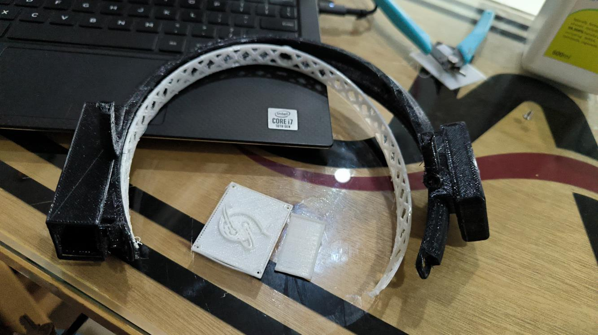

**Source:** Results and Discussion slides, page 8. Photograph of the assembled wearable.

### Printed enclosure

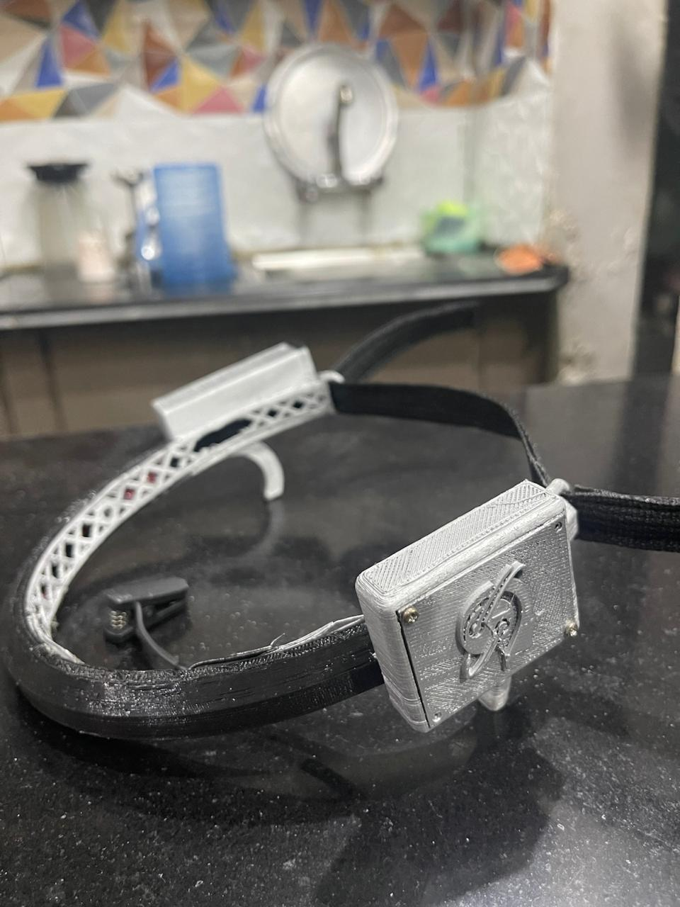

**Source:** Results slides, page 8. Physical printed housing and headband. Exact print settings and materials remain undocumented.

### Breadboard exploration

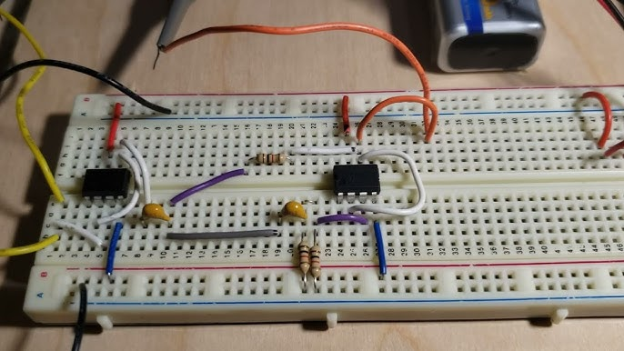

**Source:** Project PowerPoint, slide 14. Preserved as a development/exploration image. The source does not establish that this circuit became the final TGAM-based acquisition hardware or verify ownership of every source illustration.

### Instrumentation amplifier simulation

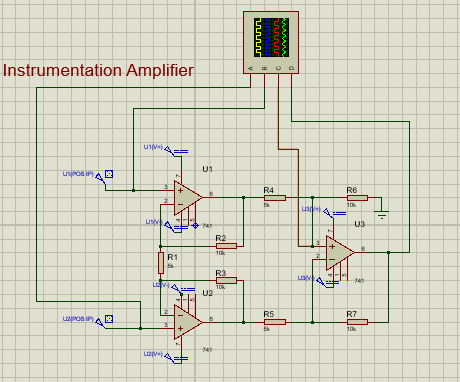

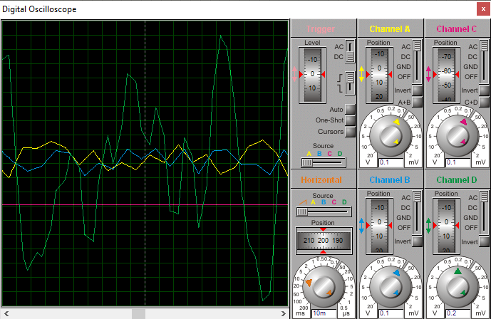

**Source:** PowerPoint, slide 11. Circuit and simulated response shown in the presentation. These are not a verified final wearable wiring diagram or a measured transfer-function report.

### Filter circuit explorations

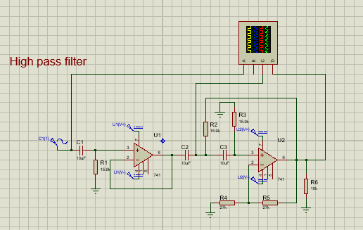

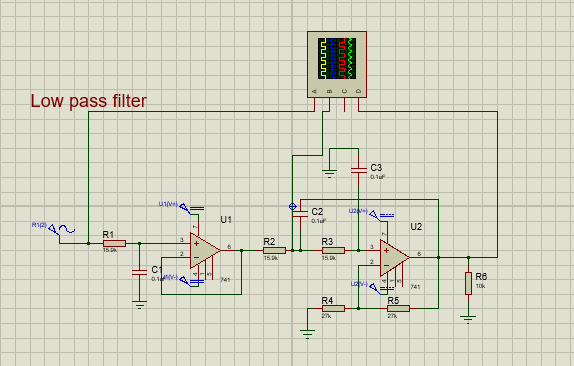

**Source:** PowerPoint, slides 12 and 13. Historical circuit-study images. Their component values and captions were not independently validated; use the manufacturer's acquisition guidance for any real build.

## Acquisition and Python GUI

### Serial output

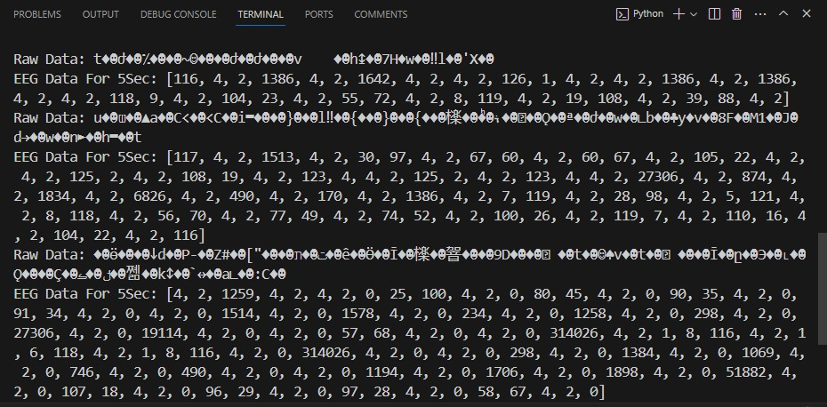

**Source:** PowerPoint, slide 15. Early serial inspection output. Displaying received bytes is a development step; it does not establish correct decoding of every EEG field.

### Spreadsheet view

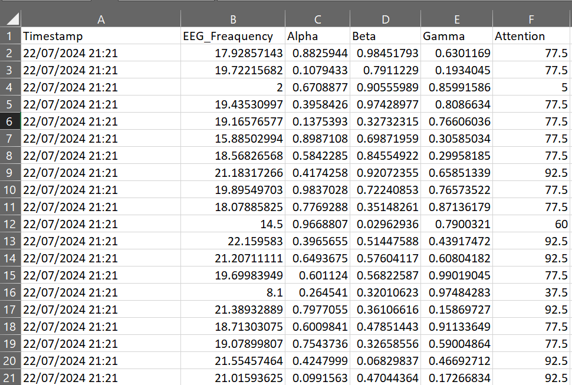

**Source:** PowerPoint, slide 16. The displayed six-column structure differs from the packaged application's two-column attention CSV. The generating/transformation pipeline is not established; see [data provenance](../data/README.md).

### Python interface

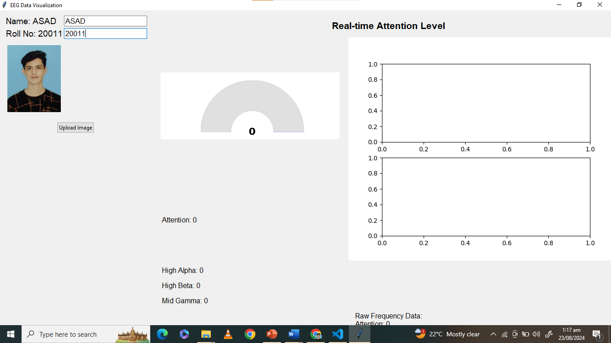

**Source:** Results slides, page 36. Student information, photograph, attention gauge, and plotting areas. This capture has empty plots and zero values; it illustrates the GUI layout rather than proving an active acquisition session. Original identifying details remain in the screenshot.

### EEG monitoring figure

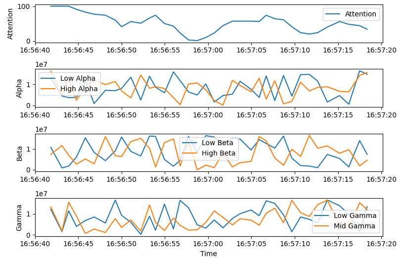

**Source:** Results slides, page 34. Attention and paired band traces from the historical results. This figure includes more bands than the selected-band display in the supplied Python script. Its exact generating code/run is unconfirmed. Existing band-power decoding issues prevent interpreting large plotted values as independently verified physiological measurements.

## MATLAB and EEGLAB exploration

### Series plot

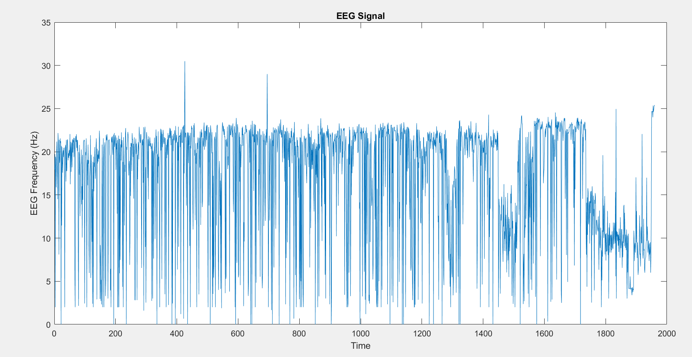

**Source:** PowerPoint, slide 20. Historical plot of the series used in that analysis. The original label and time axis are retained; the example 256 Hz assumption is not proof of the input's actual sampling rate.

### Three-panel feature plot

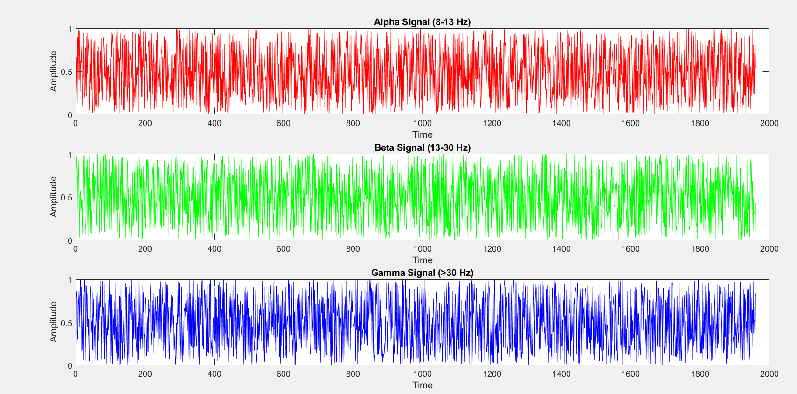

**Source:** PowerPoint, slide 21. Feature plots presented during MATLAB exploration. The supplied `eegcode.m` selects/averages existing columns; it does not establish FFT/wavelet extraction from a continuous raw recording.

### EEGLAB spectrum

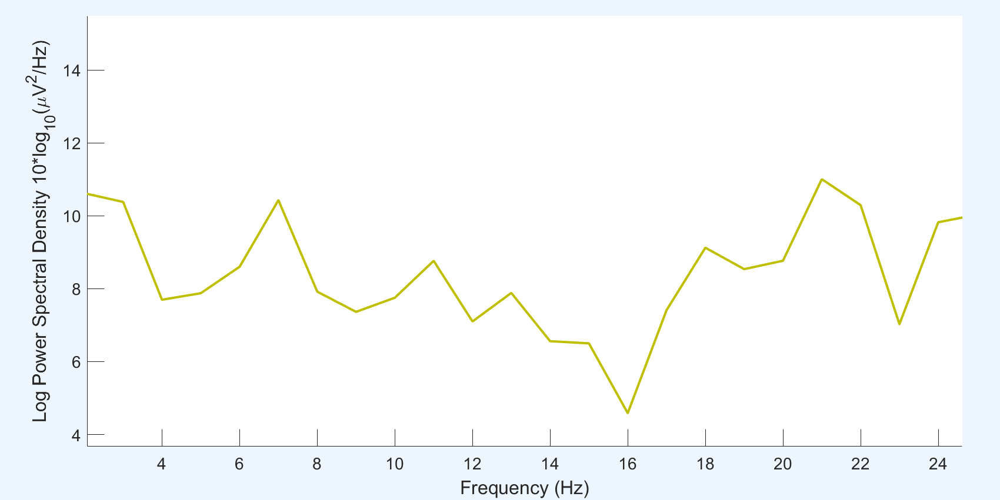

**Source:** PowerPoint, slide 26. The slide refers to a tutorial dataset. This is evidence of EEGLAB exploration, not a locally collected multichannel classroom recording. [Analysis scope](AI_AND_DATA.md#6-matlab-and-eeglab-scope).

## AI experiment and saved model outputs

The original notebook experiment and the slide figures are preserved separately because their reported results differ. Neither source has been rerun or validated in this packaging update. [Evaluation limitations](AI_AND_DATA.md#4-historical-result-and-limitations).

### Feature distributions

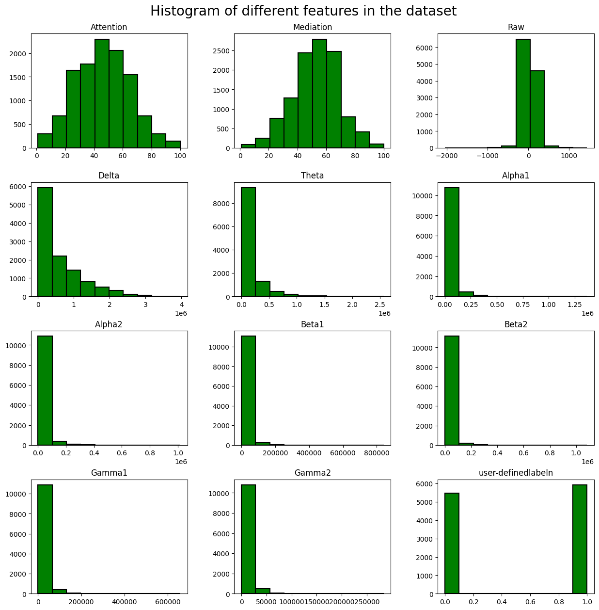

**Source:** Original notebook, cell 13. Distributions after the notebook's row filtering.

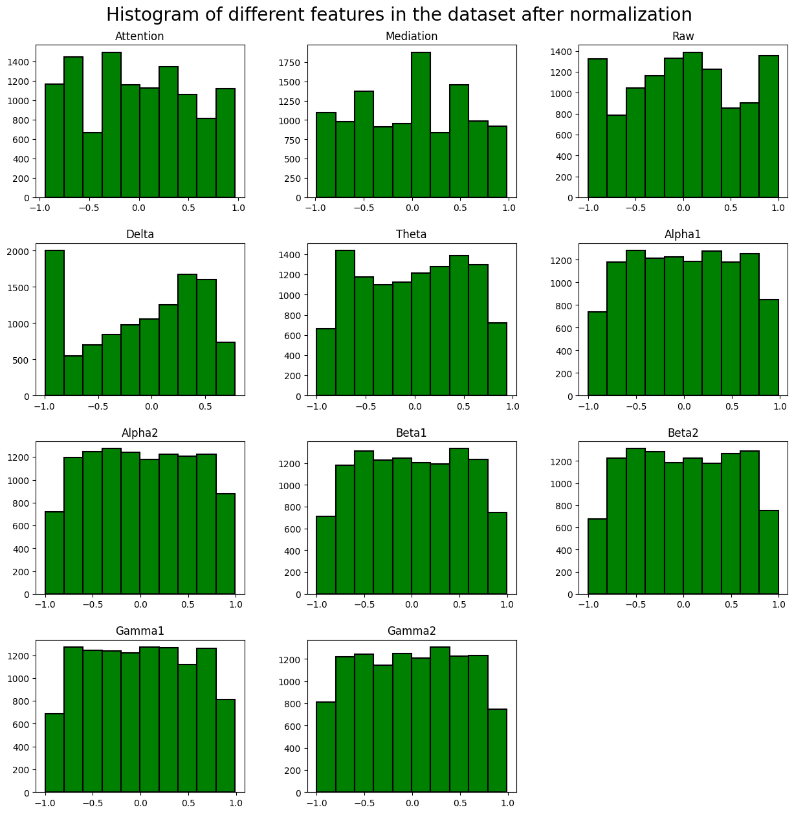

**Source:** Original notebook, cell 17. Historical normalized distributions. The original notebook fits normalization before splitting; this needs correction for valid evaluation.

### Correlation heatmap

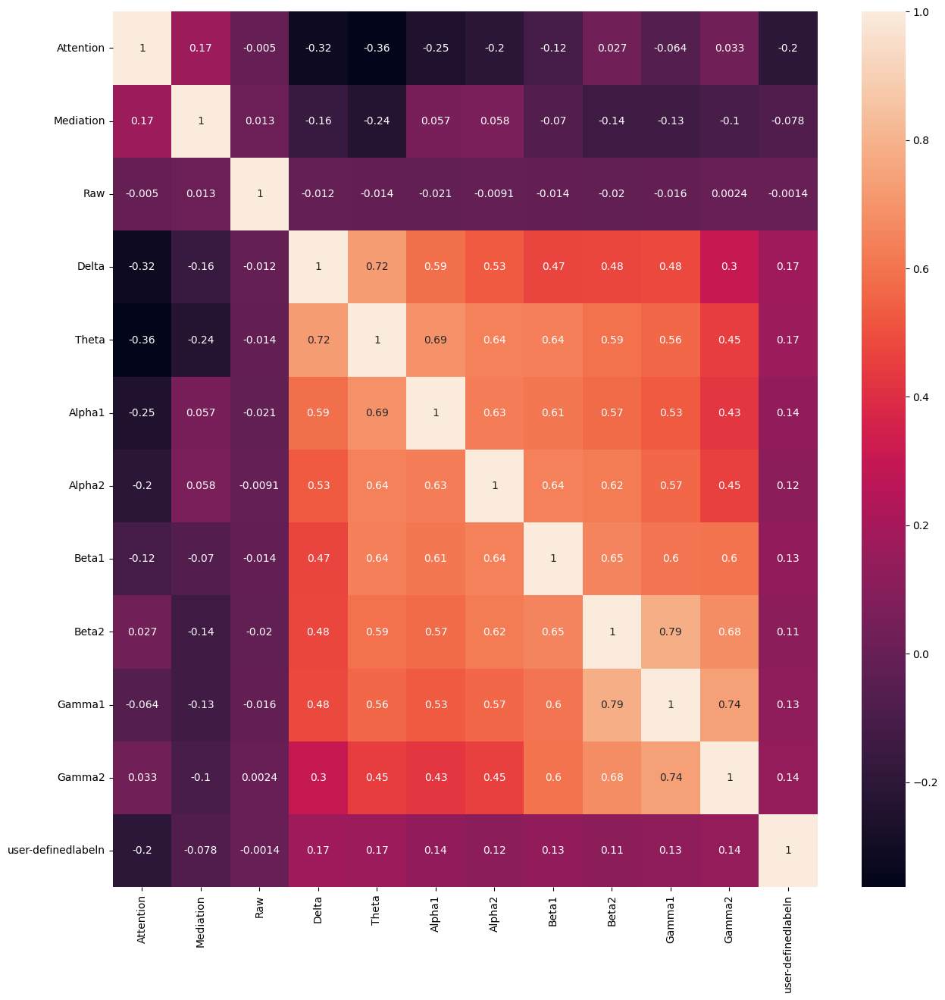

**Source:** PowerPoint, slide 34. Exploratory associations among features and the label. Correlation is not proof of a causal relationship with student performance.

### Neural-network architecture

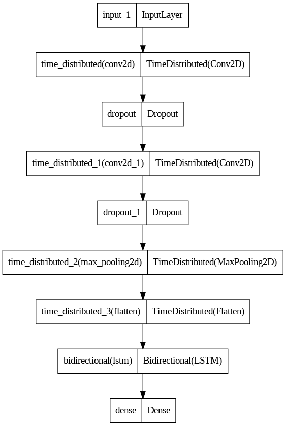

**Source:** PowerPoint, slide 35. Architecture diagram from the historical experiment. The supplied input arrangement gives the recurrent layer an outer sequence length of one; see the [shape review](AI_AND_DATA.md#3-observed-data-dimensions).

### Notebook variant 1: saved results

| Accuracy | Loss |
|---|---|
| 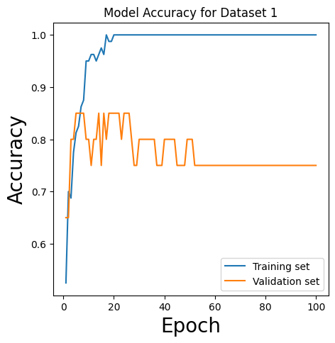 | 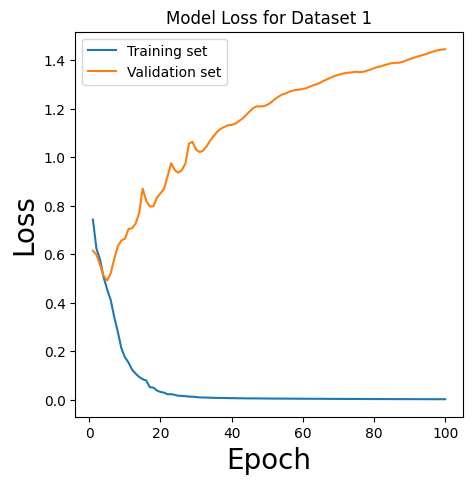 |

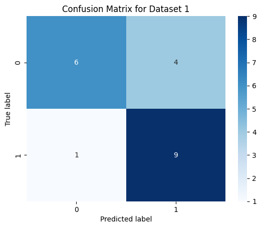

**Source:** Original notebook, cells 31 and 32. The matrix is `[[6, 4], [1, 9]]`: 15 correct predictions out of 20 entries, matching the saved 75% evaluation result. Training/validation divergence is visible. Empty sequence slots, participant overlap, normalization leakage, and validation reuse limit interpretation.

### Notebook variant 2: saved results

| Accuracy | Loss |
|---|---|
| 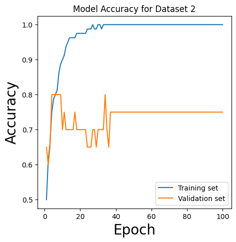 | 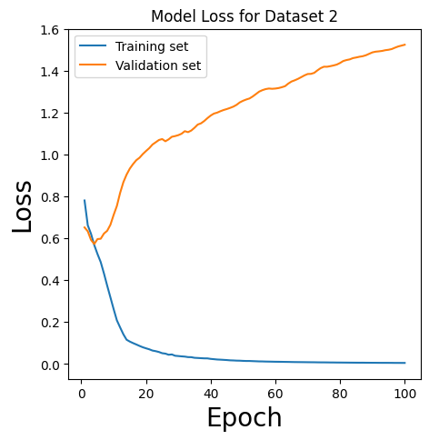 |

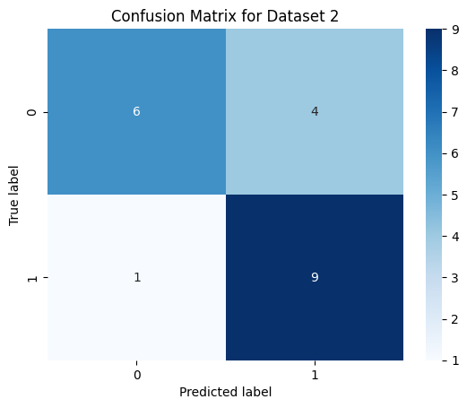

**Source:** Original notebook, saved outputs in cells 34 and 35. The saved matrix also shows 15/20 correct entries. These are a second representation of the original dataset, not results on a new independent classroom cohort.

### PowerPoint slide 36: different historical results

| Accuracy in slide | Loss in slide |
|---|---|
| 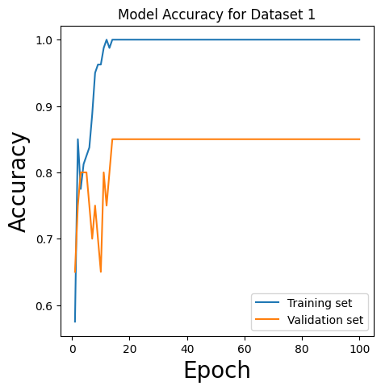 | 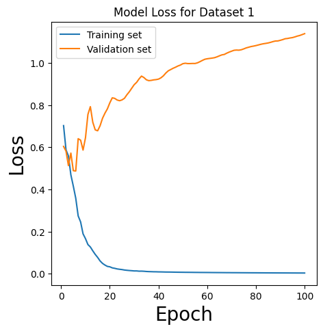 |

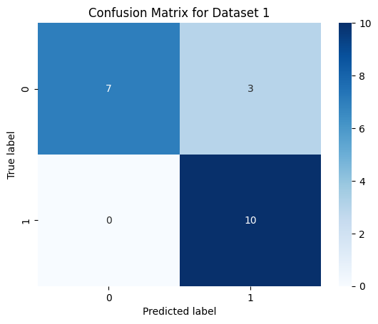

**Source:** PowerPoint, slide 36. This matrix is `[[7, 3], [0, 10]]`, or 17/20 correct entries (85%). It differs from the supplied notebook's 75% output. The training configuration and run history needed to reconcile them were not supplied. This figure is included for historical completeness, not adopted as the repository's verified accuracy.

## Power BI and result comparisons

These are original reporting screenshots. No editable `.pbix` file was found. The chart labels are preserved, even where feature naming or interpretation needs correction. They must not be treated as a controlled demonstration of improved learning.

### Complete dashboard

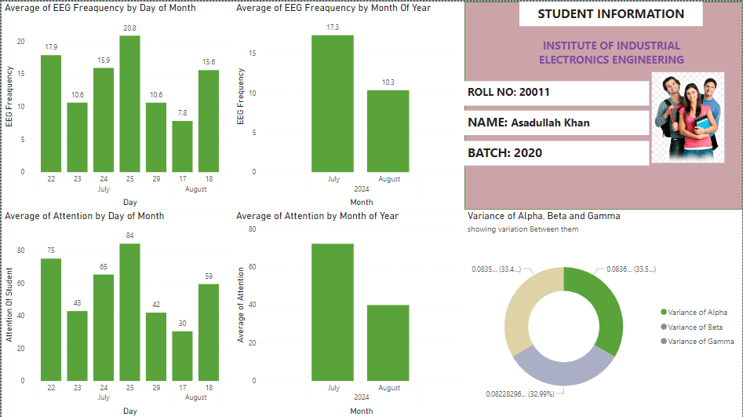

**Source:** Results slides, page 37. Daily/monthly charts, a variance graphic, and student details. Original names and roll numbers are retained.

### Daily charts

| Frequency-labeled chart | Attention chart |
|---|---|
| 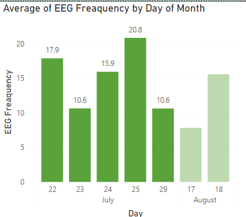 | 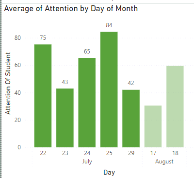 |

**Source:** Results slides, pages 39 and 40. These plots document the original reporting output; the underlying transformation pipeline and interpretation of the frequency metric are not established.

### Monthly charts

| Frequency-labeled chart | Attention chart |
|---|---|
| 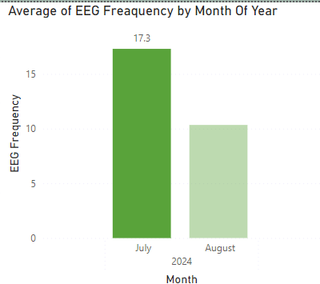 | 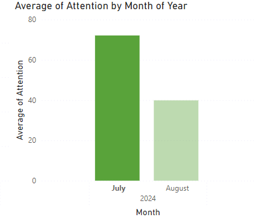 |

**Source:** Results slides, pages 41 and 42. Aggregated examples shown in the presentation. The supplied Python script alone does not reproduce these monthly reports.

### Variance graphic

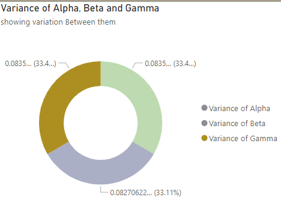

**Source:** Results slides, page 43. Original variance graphic. A similar share among plotted values does not by itself establish a physiological interpretation.

### Student comparison

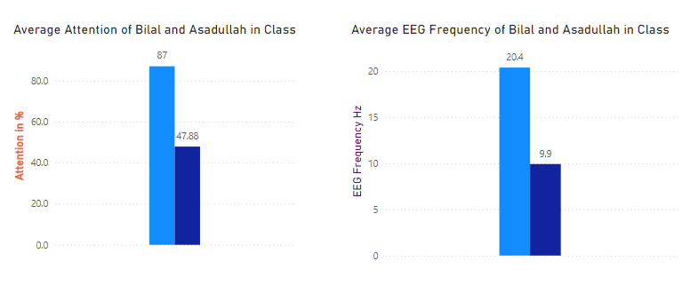

**Source:** Results slides, page 44. Historical two-student comparison. It is a descriptive presentation figure, not a controlled experiment showing that the device improved student performance.

### Attention-series comparison

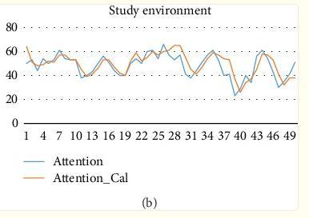

**Source:** Results slides, page 45. Original chart labeled `Attention` and `Attention_Cal`. The exact calculation, source records, and independent validation are not established; proximity of the lines alone is not evidence of predictive validity.

## Source files and traceability

- [Original editable presentation](../supporting-documents/Project-Presentation.pptx)
- [Original results slides PDF](../supporting-documents/Results-and-Discussion-Slides.pdf)
- [Packaged notebook with historical-output notice](../notebooks/confused_student_identification.ipynb)
- [Machine-readable visual index](VISUAL_INDEX.json)
- [Source hashes, image locations, and packaging changes](ASSET_PROVENANCE.json)

Extraction retains the original source content. Inclusion does not establish that every diagram/photo in the original documents was authored by the team; asset reuse remains subject to [the license notice](../LICENSE-NOTICE.md).
