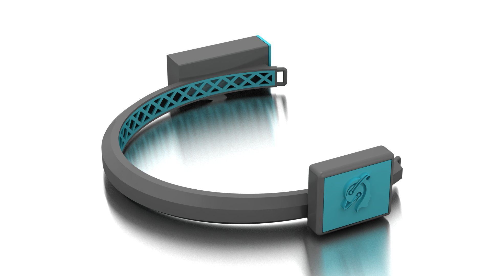
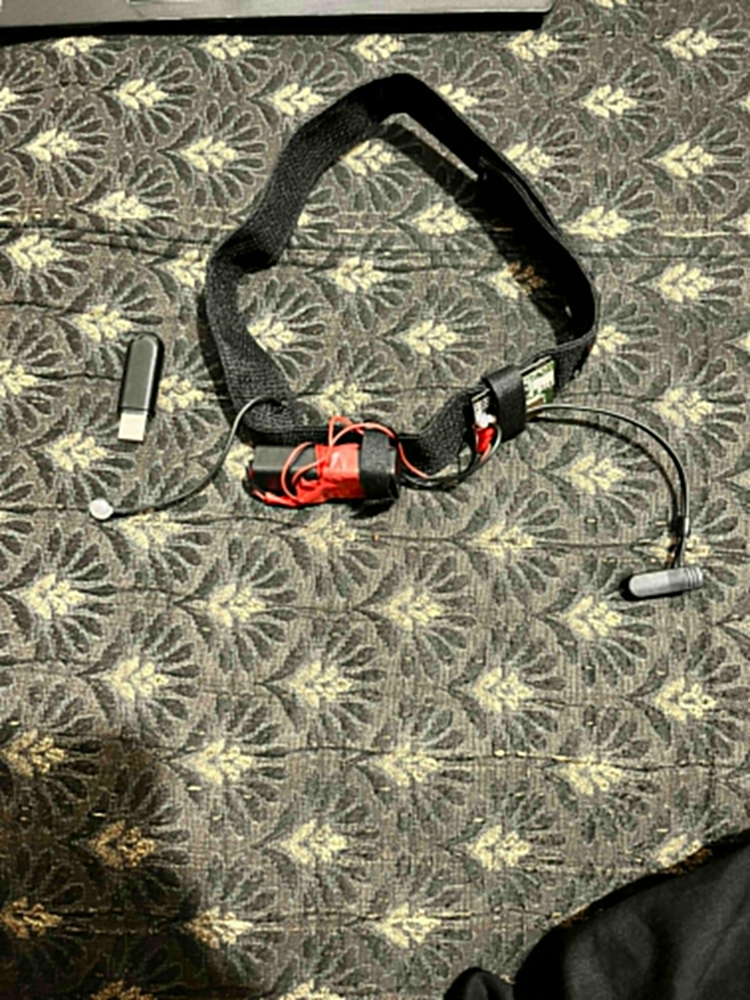

# Hardware and wearable design

[Back to README](../README.md)

[See the assembled headband, printed enclosure, breadboard, and circuit images](GALLERY.md#hardware-and-electronics), extracted from the original project presentations.

## 1. Acquisition arrangement

The documented physical implementation uses a TGAM EEG module with a dry forehead contact and an ear reference arrangement. The report names Fp1 for the forehead location and A1 for the ear reference. These location descriptions do not establish every electrode lead, connector, or pin in the final assembly.

The module provides processed metrics and EEG-related values. The supplied Python program consumes its serial packet stream; it does not implement an analog amplifier or digitizer in Python.

## 2. Communication and power

The prototype uses a Bluetooth serial link to send measurements to a computer. The application opens the serial interface at 57,600 baud. That is the source configuration, not an independently measured setting of every module photographed.

The headband is shown as a portable, battery-powered assembly. The exact Bluetooth module identifier, battery specification, regulation circuit, charging arrangement, and measured operating time require confirmation.

| Signal role | Purpose | Missing detail |
|---|---|---|
| Forehead sensing contact | Acquire a scalp potential relative to the reference arrangement | Verified electrode material, attachment, and connector |
| Reference/ground arrangement | Establish the module's required measurement reference | Final lead-to-pin mapping |
| TGAM data output to wireless interface | Carry the serial measurement stream | Verified module pins, logic levels, and configuration |
| Wireless interface to computer | Expose a serial port for the application | Module model and pairing procedure |
| Power supply to wearable electronics | Operate acquisition and communication hardware | Cell/regulator ratings, protection, and current measurements |

This is a signal-role summary, not a verified wiring schematic. Before reproducing a body-connected acquisition build, verify the manufacturer's electrode and power requirements and use an appropriate battery-powered/isolated arrangement.

## 3. Enclosure and mechanical work

The project includes design renders, a dimension drawing, photographs of the assembled device, and four mesh files:

| File | Supplied description |
|---|---|
| [main case.stl](../hardware/enclosure/main%20case.stl) | Main enclosure part |
| [inner wall.stl](../hardware/enclosure/inner%20wall.stl) | Internal enclosure part |
| [cap 1.stl](../hardware/enclosure/cap%201.stl) | First cap |
| [cap 2.stl](../hardware/enclosure/cap%202.stl) | Second cap |

Open each mesh in a CAD viewer or slicer and compare its scale with the supplied [dimension drawing](images/enclosure-dimensions.jpeg). STL does not encode a reliable physical unit convention; do not assume a scale without checking. Original parametric CAD files, printer settings, material, and measured tolerances are not established by these assets.

The engineering work represented here includes packaging electronics, accommodating sensor placement, and iterating a wearable form. Long-duration comfort, robustness, and electrode-contact performance still require measured evaluation.

## 4. What belongs to proposal work

The original documents discuss architectures involving STM32F407/417, ESP8266, Arduino/Raspberry Pi options, cloud services, and mobile interfaces. Matching firmware or deployable services were not identified in the supplied implementation. They should be described as considered/proposed options, not components confirmed in the final build.

Analog circuits and filtering discussions appear in presentations. They do not alone prove that a custom analog EEG front end was fabricated and validated as the final acquisition hardware.

## 5. Recommended hardware documentation update

1. Photograph the final board labels and electrode connectors clearly.
2. Record a bill of materials with exact part numbers and quantities.
3. Draw the final wiring from the actual assembly, including voltage and logic-level requirements.
4. Record battery capacity, current consumption, charging/protection arrangement, and measured runtime.
5. Document enclosure units, material, print settings, fasteners, cable routing, and assembly order.
6. Measure usable signal/contact quality across repeated placements and wearing conditions.

These are outstanding documentation and validation tasks; their completion is not claimed here.
