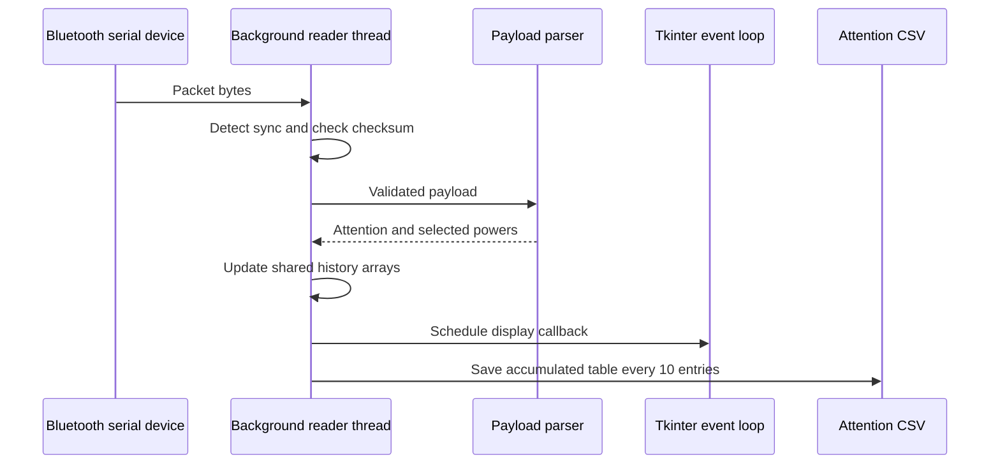

# Software, acquisition, and dashboard

[Back to README](../README.md)

[View original GUI and acquisition screenshots](GALLERY.md#acquisition-and-python-gui). These are historical captures, not newly generated application output.

## 1. Existing architecture

The [Python application](../software/tgam_dashboard.py) is a single-file desktop prototype. PySerial receives data, Python functions parse packets and update arrays, pandas accumulates attention records, Tkinter hosts the interface, and Matplotlib renders plots.

## 2. Packet handling

The reader looks for two synchronization bytes (`0xAA 0xAA`), reads a payload length, then reads the payload and checksum. The checksum comparison is `0xFF - (sum(payload) & 0xFF)`.

The parser recognizes `0x04` for attention and attempts to parse `0x83` for eight band powers. The latter format has a length byte followed by 24 bytes of data. The supplied implementation does not consume that length byte before calculating its offsets. It also does not generally skip unknown fields according to their encoded length. Both behaviors need correction.

The dashboard updates only when attention and high-alpha are both present in the parser's return values. This condition can discard otherwise usable values when fields are delivered in different packets. Proper field/state handling should follow the actual device stream.

## 3. Attention and visual categories

The interface shows the TGAM-provided attention value. It does not predict attention using the notebook model.

| Source threshold | Display label |
|---|---|
| Attention >= 80 | Best |
| Attention >= 60 and < 80 | Good |
| Attention >= 40 and < 60 | Bad |
| Attention < 40 | Worse |

These labels are programmer-defined presentation rules. They are not validated categories of student ability or understanding. A future interface should use neutral descriptions and distinguish unusable/contact-poor data from low values.

## 4. Plotting and state

The plotting arrays retain 100 entries. The source attempts to display high-alpha, high-beta, and mid-gamma values. These are intended to be relative power features, not the raw EEG waveform or a measured oscillation frequency. Some original plot labels should be corrected accordingly.

The serial loop uses a daemon thread and schedules GUI operations with `root.after`. Shared data arrays remain mutable across execution paths. A queue between acquisition and the GUI would make ownership, ordering, and shutdown easier to reason about.

Student name, roll number, and a selected photograph are interface features. They do not imply an implemented account system, persistent student database, or secure multi-user platform.

## 5. CSV and averages

The application accumulates `Time` and `Attention` rows and periodically writes the accumulated table. It saves after each ten new readings. It does not perform a guaranteed final flush at shutdown, so the last unsaved readings may be lost.

The packaged output path is `data/local/attention_session.csv`. That path replaces the original personal computer path. Reusing it can overwrite a previous session. Choose a different filename manually until unique session creation is implemented.

Daily averages use a dictionary within the current process. Restarting the application does not reload prior session records into that dictionary. A displayed average is therefore not a complete longitudinal record.

## 6. Dependencies and configuration

- Runtime imports: PySerial, NumPy, pandas, Matplotlib, Pillow, and Python's standard-library Tkinter/threading modules.
- Default serial port: `COM4`, in the application startup code.
- Source baud rate: `57600`.
- CSV destination: near the top of the file.
- Dependency versions: not pinned because a verified original environment was not supplied.

The README includes the installation commands. Do not import the application as a library to run parser tests: its top-level GUI setup has side effects. The [parser audit](../tools/audit_parser.py) safely extracts only the parser function using Python's AST module.

## 7. Remaining engineering work

Add timeouts and partial-read handling, bounded queues, signal-quality decoding, reconnect logic, structured error messages, unique session IDs, durable logging, clean shutdown, and replay-based checks. Then verify the application using the actual paired hardware and document the tested environment.

No hardware-connected execution or new GUI acceptance test was performed when preparing this repository. The included application is historical source, not a newly certified stable release.
